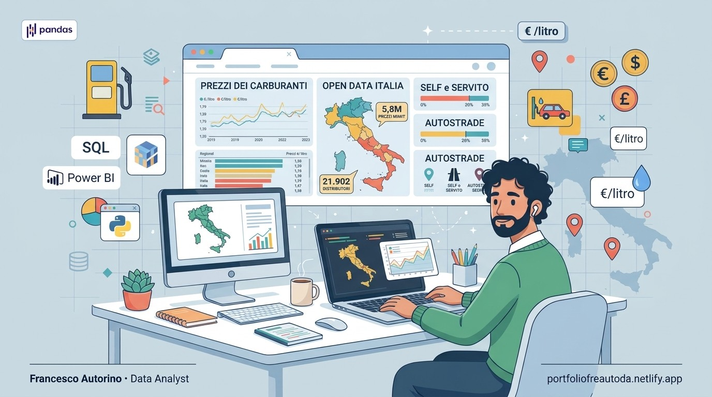
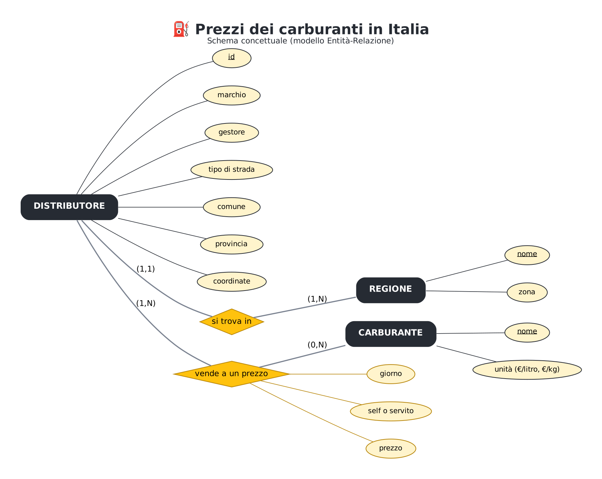
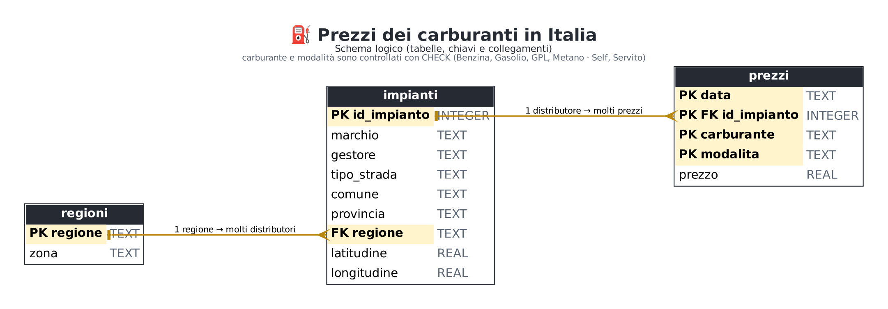

# ⛽ Prezzi dei carburanti in Italia



Progetto di **Francesco Autorino** – Data Analyst.

🛠️ Strumenti: **SQL · Power BI** (Python solo per scaricare e pulire i dati)

📊 Dati: **5,8 milioni di prezzi** di **21.902 distributori**, dal 28 luglio al 15 ottobre 2026.

📌 Dati ufficiali del Ministero (MIMIT): ogni distributore comunica i suoi prezzi, che vengono pubblicati ogni mattina alle 8.

---

## 🧭 1. Il progetto in breve

❓ **La domanda**: quanto costa fare il pieno in Italia, e come si può risparmiare?

Le 5 domande più piccole:

1️⃣ 📈 Come sono cambiati i prezzi in questi mesi?

2️⃣ 🙋 Quanto costa in più il servito rispetto al self?

3️⃣ 🗺️ In quali regioni e province si paga di più?

4️⃣ 🛣️ L'autostrada costa di più? E i marchi?

5️⃣ 📅 Conviene fare il pieno in un giorno preciso della settimana?

---

## 🎯 2. I risultati principali

📈 Benzina self: da **1,987 €** (28 luglio) a **2,034 €** (15 ottobre). Picco il **27 settembre**: **2,161 €**.

⛽ Il **gasolio** costa più della benzina: **2,253 €** al self il 15 ottobre.

🙋 Il **servito** costa **13,5 cent** in più al litro: quasi **7 €** in più su un pieno da 50 litri.

🛣️ In **autostrada** il self costa **7 cent** in più, il servito **19 cent** in più.

🗺️ **Centro e Nord** costano meno. Il **Sud** costa quasi **3 cent** in più del Centro.

🏔️ **Livigno** è zona franca: benzina a **1,62 €**. Per questo Sondrio sembra la provincia più economica.

💸 Nella stessa provincia, tra un distributore economico e uno caro si risparmiano fino a **10 €** su un pieno.

📅 Il giorno della settimana conta pochissimo: meno di **1 cent** di differenza.

🔢 Moltissimi distributori mettono la benzina a **1,999 €**: il "prezzo psicologico" sotto i 2 euro.

---

## 🛠️ 3. Perché questi strumenti

🗄️ **SQL**: 5,8 milioni di righe sono troppe per Excel. Con SQL faccio medie, classifiche e confronti in pochi secondi.

📊 **Power BI**: si sceglie il carburante e la modalità con un clic, e tutti i grafici cambiano (anche il colore).

🐍 **Python**: solo per scaricare gli 80 giorni di file e pulirli.

---

## 🔄 4. Il percorso dei dati

```
MIMIT (copia GitHub)    01_scarica.py              02_pulizia.py                 ANALISI
156 file giornalieri ──► ❌ 7,25 milioni ─────────► ✅ 5,8 milioni di prezzi ──┬──► 🗄️ SQL
prezzi + anagrafica      di prezzi grezzi           21.902 distributori        └──► 📊 Power BI
                         (1GrezziNonPuliti)         + 8 tabelle riassuntive
```

🧹 **Cosa ho fatto durante la pulizia**

| Passo | Cosa | Risultato |
|---|---|---|
| 1 | Letti gli 80 giorni (2 giorni mancano nell'archivio: 4 e 5 settembre) | 7.253.691 prezzi |
| 2 | Anagrafica: riparate le righe con il simbolo "\|" dentro nomi e indirizzi; per ogni distributore tenuti i dati più recenti | 24.216 distributori |
| 3 | Tenuti solo i 4 carburanti principali: Benzina, Gasolio, GPL, Metano | 5.822.738 prezzi |
| 4 | Tolti i prezzi "vecchi", comunicati più di 30 giorni prima | −23.716 |
| 5 | Tolti i prezzi impossibili (es. benzina sotto 1,50 € o sopra 3 €) | −822 |
| 6 | Controllati doppioni e distributori senza anagrafica | 0 |
| 7 | Aggiunte regione e zona (Nord, Centro, Sud, Isole) | 5.798.200 prezzi |

---

## 📁 5. I file in questo repository

| File | A cosa serve |
|---|---|
| `README.md` | Questo file |
| `DESCRIZIONE_GITHUB.md` | Nome, descrizione e topics del repository |
| `00_LEGGIMI.md` (in ogni cartella) | Una spiegazione corta di quella cartella |

### 📂 01SQL

| File | A cosa serve |
|---|---|
| `01_schema_concettuale.png` | 🧩 Lo schema concettuale (modello Entità-Relazione) |
| `02_schema_logico.png` | 🗂️ Lo schema logico: tabelle, chiavi PK/FK e collegamenti |
| `03_crea_database.sql` | 🏗️ Crea le tabelle `regioni`, `impianti`, `prezzi` e la vista `v_prezzi` |
| `04_query_analisi.sql` | 🔍 **19 query** divise per domanda: LAG, media mobile, RANK, ROW_NUMBER, NTILE, CTE |

🧩 **Schema concettuale**



🗂️ **Schema logico**



### 📂 02PowerBi

| File | A cosa serve |
|---|---|
| `01_CarburantiDashboard.zip` | ⭐ **La dashboard**: estrai lo zip e apri `Carburanti_Dashboard.pbip` con Power BI Desktop |
| `02_Carburanti_Dashboard.pdf` | 📄 La dashboard in PDF |
| `03_misure_DAX.txt` | 🧮 Le 21 misure DAX |

📊 **Le 4 pagine della dashboard**

1. **Panoramica**: 6 numeri chiave come i cartelli dei distributori, il prezzo giorno per giorno, zone d'Italia, giorni della settimana
2. **Dove costa di più**: l'Italia disegnata con le province (verde, giallo, rosso), le regioni, la classifica delle province
3. **Come risparmiare**: self e servito, strada e autostrada, marchi, quanti distributori per prezzo
4. **Conclusioni**

🎛️ In alto si sceglie il **carburante** (Benzina, Gasolio, GPL, Metano) e **self o servito**.
I grafici prendono il colore del carburante scelto.

---

## 📦 6. Dati e script

📌 Qui ci sono solo i **risultati**: schemi, query e dashboard.

📥 I dati si possono riscaricare dalla fonte (link più sotto).

🐍 Gli script Python di raccolta e pulizia dei dati e il database sono disponibili su richiesta.

---

## ⚠️ 7. Limiti

📌 Solo 80 giorni (28 luglio – 15 ottobre 2026), con 2 giorni mancanti.

📌 Sono i prezzi delle 8 di mattina comunicati dai gestori: durante il giorno possono cambiare.

📌 Le medie sono semplici tra distributori: non sono pesate sui litri venduti.

📌 Non conosciamo sconti, carte fedeltà e promozioni.

---

## 🔗 8. Da dove arrivano i dati (link)

| Fonte | Cosa ho preso | Link |
|---|---|---|
| MIMIT – Osservatorio prezzi carburanti | La fonte ufficiale: prezzi e anagrafica dei distributori | https://www.mimit.gov.it/it/open-data/elenco-dataset/carburanti-prezzi-praticati-e-anagrafica-degli-impianti |
| MIMIT – Archivio prezzi | Lo storico ufficiale | https://www.mimit.gov.it/index.php/it/open-data/elenco-dataset/carburanti-archivio-prezzi |
| GitHub "LucaDDDD/benzina-data" | La copia giornaliera dei file MIMIT usata da `01_scarica.py` | https://github.com/LucaDDDD/benzina-data |
| File scaricati | Un file al giorno di prezzi e uno di anagrafica | https://raw.githubusercontent.com/LucaDDDD/benzina-data/main/data/2026/10/prezzo_alle_8-20261015.csv.gz (e gli altri giorni) |

📅 Dati scaricati il **27 ottobre 2026**.

⚖️ Dati del Ministero delle Imprese e del Made in Italy, pubblicati come open data.

---

## 🪜 9. Tutti i passaggi fatti, in ordine

1️⃣ **Scelta del progetto**: un tema che riguarda tutti, con tanti dati ufficiali.

2️⃣ **Domande**: ho fissato le 5 domande.

3️⃣ **Raccolta** (`01_scarica.py`): il sito del Ministero non era raggiungibile, quindi ho usato una copia su GitHub che salva i file ogni giorno.

4️⃣ **Controllo**: 2 giorni mancanti, righe dell'anagrafica rotte, prezzi vecchi o impossibili.

5️⃣ **Pulizia** (`02_pulizia.py`): 4 carburanti, prezzi recenti e realistici, regioni e zone.

6️⃣ **Tabelle riassuntive**: andamento giornaliero, regioni, province, marchi, strada, giorni, distribuzione.

7️⃣ **SQL**: schema concettuale e logico, database SQLite con 3 tabelle e una vista, 19 query provate.

8️⃣ **Power BI**: dashboard di 4 pagine con filtri a pulsanti e mappa delle province, aperta e controllata in Power BI Desktop.

9️⃣ **PDF**: esportata la dashboard in `Carburanti_Dashboard.pdf`.

🔟 **Conclusioni**: risposte alle domande e consigli per risparmiare.
